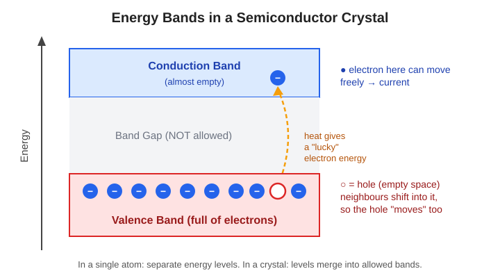
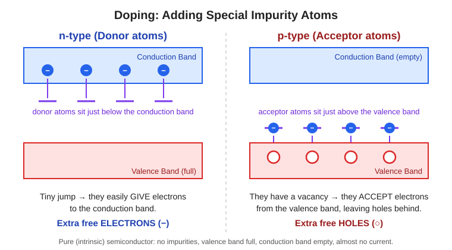
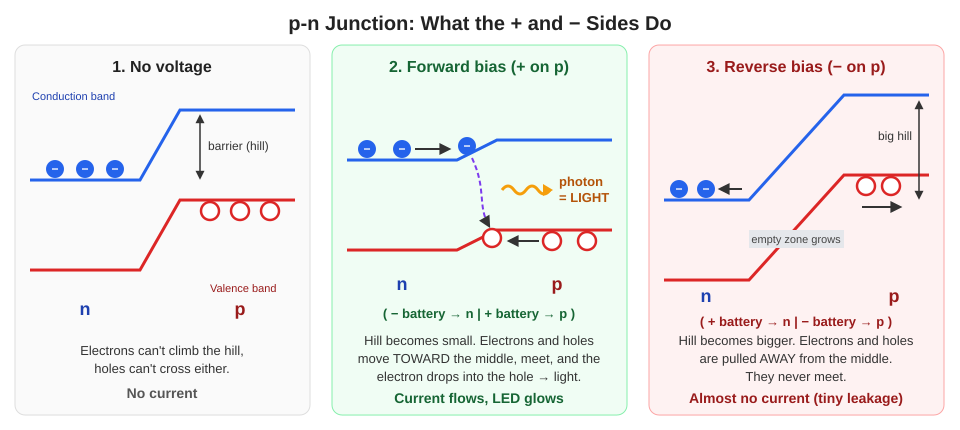
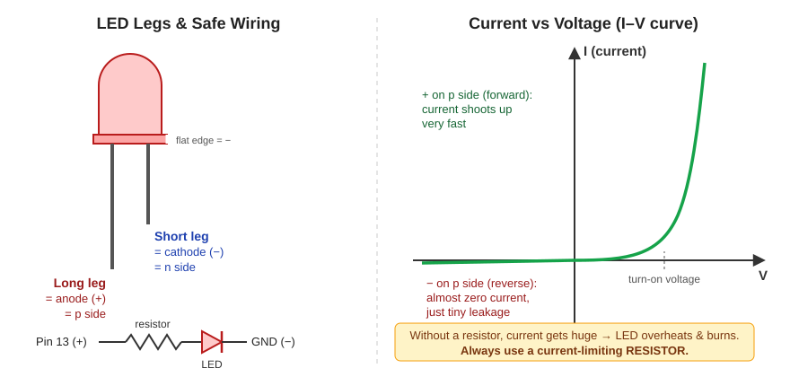
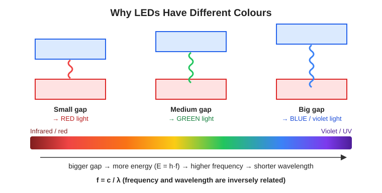

# Day 2: How LEDs Work

**Source:** Paul McWhorter, New Arduino Tutorials, Video #2 (YouTube)

📄 [My handwritten notes (PDF)](handwritten-notes.pdf)

---

## 1. Why not a normal light bulb?

In a normal (filament) bulb, electricity heats up a thin wire until it glows.
About **95% of the energy becomes heat** and only about **5% becomes light**.
That's a lot of wasted energy. To solve this, we use **LEDs**.

To understand LEDs, we first need to understand **semiconductors**.

## 2. Semiconductors

- A semiconductor can be manufactured and customised to act like a **conductor** or an **insulator**, depending on the electric signal.
- Most electronic devices are built from semiconductor materials that use **silicon**, e.g. computer chips and microcontrollers (like the one on the Arduino).
- So almost everything in the world of computers is based on semiconductors.

## 3. Energy bands

- In a single atom, electrons sit at **specific energy levels** (states).
- Semiconductors are **crystals**: their atoms are arranged in perfect symmetry.
- When we bring atoms together to form a crystal, the electrons no longer have separate energy levels. Instead they live in **allowed bands**:
  - **Valence band:** full of electrons
  - **Band gap:** energies that are NOT allowed
  - **Conduction band:** almost empty. Electrons here can move freely, which gives current.

- When we give the crystal some thermal energy (heat), a "lucky" electron jumps from the valence band to the conduction band.
- That electron can now move → **conduction**.
- It leaves an empty space behind in the valence band called a **hole**. Neighbouring electrons shift into the hole, so the hole also moves → also conduction.
- It's easier to think of **one hole moving** instead of millions of electrons shifting.
- In band diagrams: **electrons roll downhill**, **holes float uphill**.

## 4. Doping: n-type and p-type

**Question:** What if we place specially designed impurity atoms in the crystal?

| | n-type | p-type |
|---|---|---|
| Impurity atoms | **Donor** atoms | **Acceptor** atoms |
| Where they sit | Just below the conduction band | Just above the valence band |
| What they do | Easily **give** electrons to the conduction band | Have a vacancy, so they **accept** electrons from the valence band |
| Result | Extra free **electrons** | Extra **holes** left in the valence band |

**Intrinsic (pure) semiconductor:** no impurities, valence band full, conduction band empty. No current flows except a few random, "lucky" electrons.

## 5. The p-n junction (this is a diode)

**Question:** What if I put p-type material next to n-type material?

- It is manufactured so there are donor atoms on one side (n) and acceptor atoms on the other side (p).
- The energy bands get an **offset**, like a step or hill, at the junction:
  - n side: electrons in the conduction band
  - p side: holes in the valence band
- This hill (barrier) stops electrons and holes from crossing on their own.

### Applying voltage

| | Forward bias | Reverse bias |
|---|---|---|
| Connection | **+ to p side**, − to n side | − to p side, + to n side |
| Barrier (hill) | Gets **lower** | Gets **higher** |
| Electrons & holes | Pushed **toward** the junction, they meet | Pulled **away** from the junction |
| Current | Flows easily, increases very fast | Almost none (tiny leakage current) |

👉 So a **diode only works in one direction**. Hook it up correctly!

## 6. LED legs and the resistor

- **Long leg = anode (+) = p side** → always connect toward the **+ voltage**
- **Short leg = cathode (−) = n side** → connect toward **GND (−)**
- In forward bias, current rises very rapidly. Too much current makes the LED heat up and **burn out**.
- To prevent this, **always connect a current-limiting resistor** in series with the LED.

## 7. How the LED makes light

- With **+ on the p side**, the barrier becomes low, so it's easier for electrons and holes to move.
- Electrons from the n side move toward the junction with extra energy.
- An electron **drops down** from the conduction band into a hole in the valence band.
- The energy it loses is released as a **photon**, and that photon is the **light** we see.

## 8. Colours of LEDs

- Energy of the photon: **E = h·f** (h = Planck's constant, f = frequency)
- The **larger the gap** between the two bands, the **higher the frequency** of the photon.
- **f = c / λ**: frequency is inversely related to wavelength (λ).
- Higher frequency → shorter wavelength:
  - **f ↑, λ ↓** → blue, violet, UV
  - **f ↓, λ ↑** → red, infrared

So the **colour of an LED depends on the size of its band gap**, which is chosen by the material it's made from.

---

## What confused me
- (write here)
